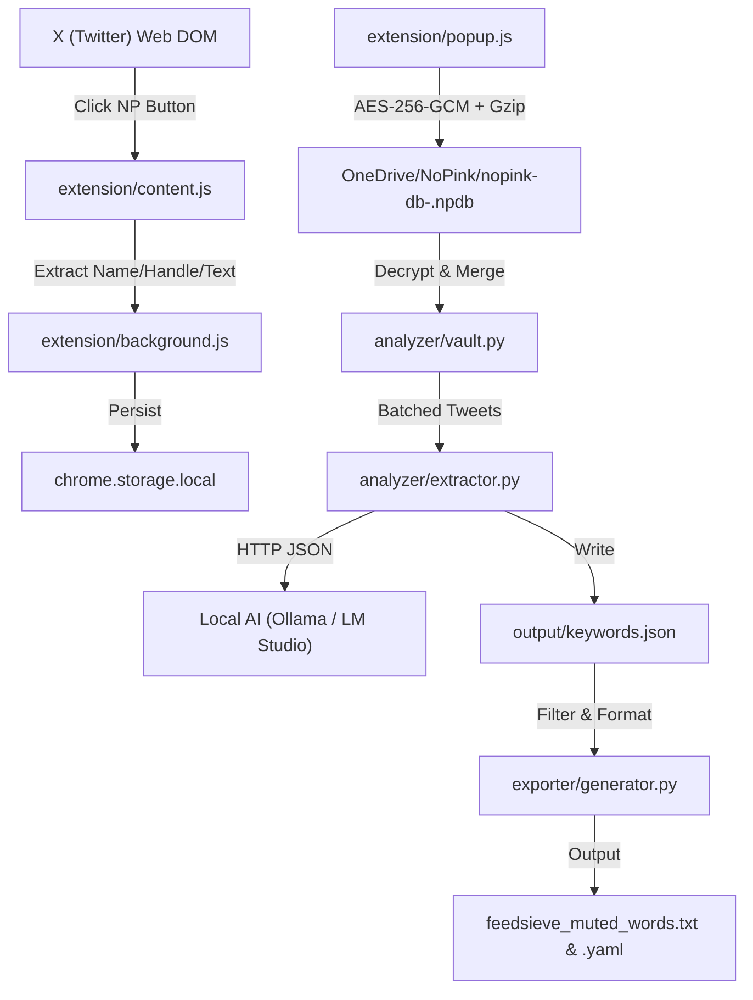

# Architecture Specification (ARCHITECTURE.md)

本文档定义 **NoPink** 的系统分层架构、模块边界、目录分配及 `.npdb` 加密数据库契约。

---

## 1. Architectural Principles

1. **三段解耦（Pipeline Isolation）**：
   - `extension/`（采集端）→ `*.npdb`（加密存储契约）→ `analyzer/`（本地 AI 提纯）→ `keywords.json` → `exporter/`（FeedSieve 导出）。
   - 各阶段仅通过明确定义的数据契约文件交互，互不直接依赖运行环境。
2. **零明文落盘（Zero-Plaintext at Rest on Sync）**：
   - 同步至 OneDrive 的 `.npdb` 文件仅包含元信息（`machineId`、`exportedAt`、`count`）与加密压缩后的密文 `payload`。
   - 任何用户名、推特 ID、发言正文均不得以明文形式出现在 OneDrive 文件中。
3. **多机无冲突（Per-Machine Sharding）**：
   - 每台电脑拥有独立的 `machineId`（如 `pc-8f3a1c2d`），仅写入 `nopink-db-<machineId>.npdb`，彻底避免 OneDrive 多端同步产生文件锁或冲突副本。

---

## 2. System Topology



---

## 3. Directory Layout & Partition Mapping

```text
NoPink/
├── extension/                  # Partition 1: Chrome Manifest V3 扩展
│   ├── manifest.json
│   ├── crypto.js               # AES-256-GCM + PBKDF2 + Gzip 加解密封装
│   ├── content.js              # X 页面 DOM 监听与头像旁采集按钮注入
│   ├── styles.css              # 采集按钮与 Toast 样式
│   ├── background.js           # 存储管理、去重与下载导出协调
│   ├── popup.html              # 扩展弹窗界面
│   └── popup.js                # 口令输入、OneDrive 目录授权与加密导出
├── analyzer/                   # Partition 2: 本地 AI 关键词筛选
│   ├── __init__.py
│   ├── vault.py                # .npdb 解密与多机数据合并去重
│   ├── llm_client.py           # Ollama / OpenAI-compatible 统一客户端
│   ├── extractor.py            # 两阶段 Map-Reduce 关键词提纯逻辑
│   ├── cli.py                  # 命令行入口
│   └── prompts/
│       ├── keyword_extract.md      # 第一阶段：批次核心词提取提示词
│       └── keyword_consolidate.md  # 第二阶段：去重与常见词剔除提示词
├── exporter/                   # Partition 3: FeedSieve 词库导出
│   ├── __init__.py
│   ├── generator.py            # 生成 .txt / .yaml / report.json
│   └── cli.py                  # 命令行入口
└── tests/                      # 跨模块自动化测试
    ├── test_vault.py
    ├── test_extractor.py
    └── test_exporter.py
```

---

## 4. `.npdb` Encrypted Vault Contract (`nopink-db-v1`)

文件命名：`nopink-db-<machineId>.npdb`（UTF-8 JSON 信封，无明文推文内容）：

```json
{
  "format": "nopink-db-v1",
  "machineId": "pc-a1b2c3d4",
  "exportedAt": "2026-11-22T09:40:00.000Z",
  "count": 42,
  "kdf": "PBKDF2-SHA256",
  "iterations": 200000,
  "cipher": "AES-256-GCM",
  "compression": "gzip",
  "salt": "<base64 16 bytes>",
  "iv": "<base64 12 bytes>",
  "payload": "<base64 AES-GCM(gzip(utf8_json))>"
}
```

解密并解压后的明文结构（仅存在于内存）：

```json
{
  "machineId": "pc-a1b2c3d4",
  "records": [
    {
      "id": "sha256_or_tweet_id",
      "displayName": "显示名称",
      "handle": "@username",
      "tweetText": "发言正文",
      "tweetUrl": "https://x.com/username/status/1234567890",
      "capturedAt": "2026-11-22T09:35:00.000Z"
    }
  ]
}
```
