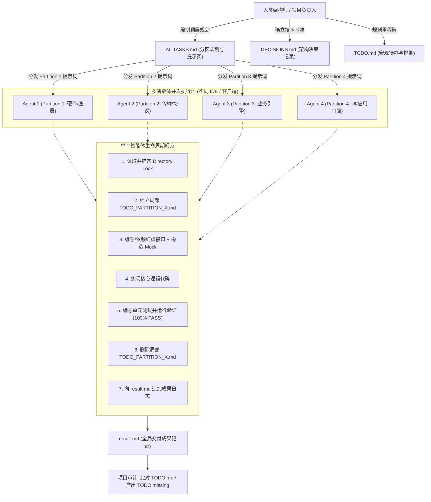

# 多智能体协同研发工作流操作指南 (WORKFLOW_GUIDE.md)

## 1. 协作模型图解



---

## 2. 单个智能体标准化操作步骤 (SOP)

### 第一步：环境对齐与输入锁定
1. 智能体接收人类指派的任务提示词（从 `AI_TASKS.md` 复制）。
2. 第一时间核查：
   - 目标路径是否受到严格目录锁保护。
   - 是否存在跨目录依赖；如果有，对方是否已暴露纯虚头文件（如 `IModuleApi.h`）。

### 第二步：建立临时任务看板
智能体在当前项目根目录创建临时的任务清单：`TODO_PARTITION_{N}.md`。
- 将任务拆解为小而可测试的 4~8 个具体步骤（Step 1 ~ Step N）。
- 每完成一步立即打勾，避免上下文过长或崩溃时遗失进度。

### 第三步：Mock-First（测试驱动先行）
- 若依赖的同级/下级模块尚由其他智能体并行开发或未开发，**绝不等待**。
- 在本地单测目录创建 `MockXxx`（例如 `MockSigner`、`MockTransport`、`MockDecoder`），用内存桩或回放数据包驱动逻辑闭环。

### 第四步：编码与严格无警告编译
- 严格遵循现代语言标准（例如 C++20，禁止裸指针所有权）。
- 所有网络端点、IP、端口均保持可配置，杜绝业务硬编码。
- 编译诊断要求：开启高警告级别（如 `/W4`、`-Wall -Wextra`），保持 **0 错误、0 警告**。

### 第五步：单元测试与全量套件验证
- 必须包含针对正常流、边界截断、异常状态重连或恢复的测试用例。
- 运行测试套件（如 CTest / pytest / cargo test），确保既有历史测试与新增测试 100% 全部通过。

### 第六步：清理与归档
- 确认全部小步骤完成后，**安全删除 `TODO_PARTITION_{N}.md`**。
- 将本次完成的核心模块、架构决策关联、缺陷修复及运行指标，以追加（Append）形式写入 `result.md`。

---

## 3. 人类架构师的项目管控节奏

| 阶段 | 核心动作 | 关键交付物 |
| :--- | :--- | :--- |
| **启动期** | 定义愿景与范围、敲定前序技术基线决策 | `PROJECT.md`, `DECISIONS.md (DEC-001/002)` |
| **拓扑期** | 确立接口契约、画出无环依赖拓扑图、生成分区 Prompts | `ARCHITECTURE.md`, `AI_TASKS.md` |
| **并行开发期** | 将 Prompts 分发至各 AI 会话，智能体各司其职并发攻坚 | 各目录源码、`Mock*.h`、单元测试套件 |
| **联调验收期** | 门面整合（Service & App）、跑通端到端无头集成测试 | 全量测试 100% 通过、`result.md` |
| **收尾与缺漏复盘** | 检查所有 AI 任务、删除 `AI_TASKS.md`、对照 `TODO.md` 输出盲区 | `TODO_missing.md`, 归档模板库 |

---

## 4. 常见问题与应急规程 (Troubleshooting)

1. **头文件符号冲突（例如 Win32 宏与 C++ 方法重名）**：
   - 规避手段：在纯虚接口或服务层中严格加宏隔离保护：
     ```cpp
     #ifdef SendMessage
     #undef SendMessage
     #endif
     ```
2. **多线程死锁风险**：
   - 遵循单向调用原则；向外部观察者分发事件（EventBus / Observer）时，**必须在释放内部互斥锁之后（锁外触发）**，杜绝回调重入死锁。
3. **平台私有 SDK 与跨平台编译冲突**：
   - 将平台强绑定的实现（如 Windows Media Foundation、WinSock 蓝牙）放入特定目录，并在头文件使用 `#ifdef _WIN32` 条件编译或动态 `LoadLibrary` 延迟绑定。
